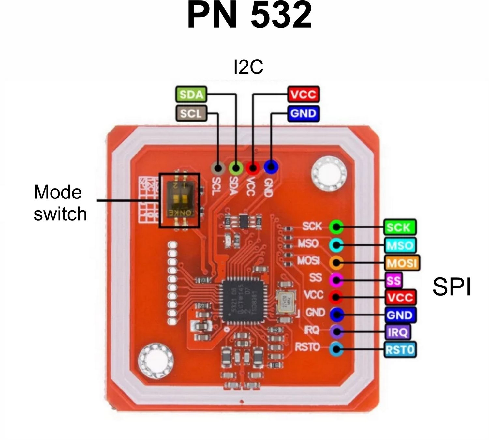
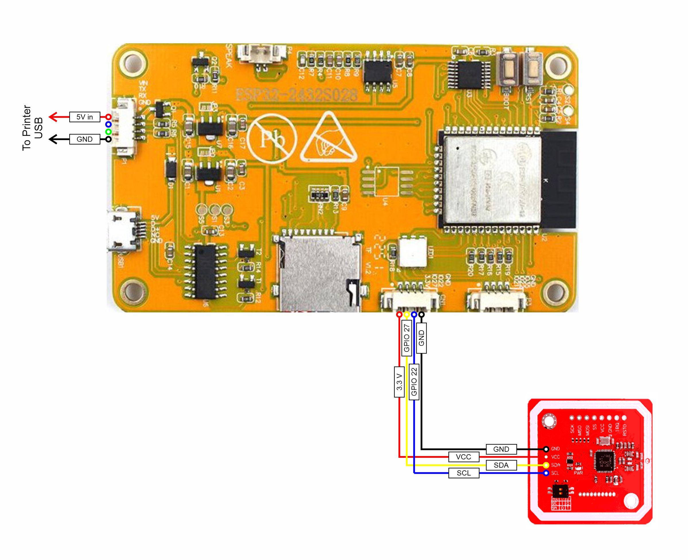

# EDOL AMS Terminal

> Smart NFC-powered terminal for managing filament spools in the EDOL ecosystem.

---

## Overview

EDOL AMS Terminal is a compact ESP32-based touchscreen device designed for fast filament spool management.

The device integrates with the EDOL backend and allows users to:

* Scan NFC filament tags
* View spool information
* Encode new NFC tags
* Erase NFC tags
* Assign spools to AMS slots
* Monitor AMS status
* Display environmental information
* Manage WiFi and EDOL AMS connection settings

The terminal is designed as a dedicated appliance for workshops, maker spaces, and 3D printing environments.

---

## Features

* ESP32-based standalone device
* Touchscreen user interface (LVGL)
* NFC spool scanning
* NFC tag encoding
* AMS slot assignment
* WiFi configuration UI
* EDOL AMS integration
* Idle screen with live AMS data
* Automatic display dimming
* Lightweight embedded firmware

---

## Compatibility

⚠️ This project works **only** with the EDOL ecosystem.

Required backend project:

* [https://github.com/serge-ponomarenko/edol](https://github.com/serge-ponomarenko/edol)

The device depends on EDOL AMS APIs for:

* spool resolution
* AMS state synchronization
* spool assignment
* environmental data

---

# Hardware

## Required Components

| Component                              | Notes                         |
| -------------------------------------- | ----------------------------- |
| ESP32-2432S028R (Cheap Yellow Display) | Main controller + touchscreen |
| PN532 NFC Module                       | NFC reader/writer             |
| NFC Tags                               | NTAG213/215/216 recommended   |
| Jumper Wires                           | Connection wiring             |
| USB-C Cable                            | Power + firmware upload       |
| 3D Printed Case                        | Optional                      |

---

## ESP32-2432S028R (Cheap Yellow Display) Pinout


---

## PN532 NFC Module Pinout



---

## Wiring Diagram



### Example Pin Mapping for I2C connection

| Component      | ESP32 Pin |
| -------------- | --------- |
| PN532 SDA      | GPIO 27   |
| PN532 SCL      | GPIO 22   |
| PN532 VCC      | 3.3 V     |
| PN532 GND      | GND       |


---

## Device Photos

> TODO: Add photos of assembled device.

### Front View


### Back View


---

## 3D Printable Case

MakerWorld links:

* TODO: Add MakerWorld link
* TODO: Add MakerWorld link

---

# Firmware

## Installing over WEB Installation (recommended)

https://serge-ponomarenko.github.io/edol-ams-terminal/

## Building from Source

### Requirements

* VSCode
* PlatformIO extension
* USB drivers for ESP32 board

### Clone Repository

```bash
git clone https://github.com/YOUR_USERNAME/edol-ams-terminal.git
cd edol-ams-terminal
```

### Build Firmware

```bash
pio run
```

### Upload Firmware

```bash
pio run --target upload
```

### Serial Monitor

```bash
pio device monitor
```

---

# Configuration

## Initial Setup

On first boot the device automatically opens the Settings screen.

Configure:

* WiFi SSID
* WiFi Password
* EDOL AMS Host
* EDOL AMS Port
* Printer ID (UUID from EDOL)

For home mode, these settings retain the existing trusted-network HTTP flow.

After saving settings the device reboots automatically.

## Secure Multi-Tenant Enrollment

Secure mode is a separate deployment mode. It is not enabled by a home-mode
configuration and never falls back to HTTP.

Before enrollment, the deployment must provide an AMS HTTPS endpoint whose
certificate chains to the PEM value compiled as `EDOL_AMS_ROOT_CA_PEM`. The
certificate must match the configured AMS host. The terminal deliberately fails
closed when the CA is absent, its TLS clock cannot synchronize through NTP, or
certificate validation fails.

The project supplies a PlatformIO build hook for the trusted CA. It reads a
public CA PEM from a protected local path and injects it only into the firmware
build; it never writes the PEM to this repository. For a secure image, set
`EDOL_TERMINAL_SECURE_BUILD=1` and `EDOL_AMS_ROOT_CA_FILE` to the CA PEM path
before running `pio run`. The secure build fails if the CA-file input is absent
or malformed. The deployment's existing ingress or PKI process supplies this
CA; an operator must not create a certificate for an individual terminal or
enrollment.

The ESP32 must be provisioned with flash encryption and secure boot before an
enrollment attempt. Terminal credentials are stored only in the encrypted NVS
namespace after these hardware checks pass; LittleFS remains only for ordinary
WiFi and endpoint settings.

An EDOL Hub owner opens the printer's **AMS Terminal** section and creates a
pairing for exactly one printer. Hub displays a 10-character code once with an
expiration countdown. On the terminal Settings screen, enter the printer UUID
and that code, then choose **ENROLL**. The terminal sends the code once to
`POST /api/terminal/v1/enroll` over TLS. On success it stores the returned
terminal credential and immediately switches to secure mode. The screen shows
completion, pairing-code, rate-limit, and TLS/connectivity failures without
displaying a secret. The code and credential must not be recorded, copied into
source, or entered in any other terminal field.

Ordinary enrollment requires no direct HTTP call, developer tools, temporary
proxy, or per-enrollment certificate. If a pairing is still pending, Hub keeps
it active until expiry. After expiry, the owner can choose **Regenerate expired
pairing**; **Replace terminal** is the explicit action when a valid pending
code must be invalidated. Hub also provides owner-confirmed credential
rotation, revocation, replacement, and factory-reset actions.

Secure mode uses only the terminal credential on these AMS paths:

- `GET /api/terminal/v1/state`
- `GET /api/terminal/v1/find?id={spoolId}`
- `POST /api/terminal/v1/set-spool`

It never sends a tenant ID or an operational `printerId`; AMS derives both from
the authenticated terminal record. Revocation, rotation, replacement, and a
factory reset require a new owner-issued pairing. A terminal without a stored
credential does not enter secure operational mode. For a physical reset, the
owner must first revoke or factory-reset the terminal through Hub. The
terminal's **FORGET SECURE** action then clears only its local encrypted-NVS
credential and restarts; it never authorizes or performs the server-side
lifecycle operation.

---

## Recovering from Invalid WiFi Settings

If the device cannot connect to WiFi:

1. Open the Settings screen using the ⚙ button on the Loading screen
2. Update WiFi credentials
3. Save settings
4. Device will reboot automatically

---

# Usage

## Home Screen

The Home Screen displays:

* AMS status
* Temperature
* Humidity
* Current staged spool
* Connection state

---

## Scanning a Spool

1. Place NFC tag near the reader
2. Device resolves spool information from EDOL
3. Spool information appears in the staging panel

---

## Assigning Spool to AMS (Automatic mode)

1. Scan spool NFC tag
2. Insert spool into desired slot
3. Wait until EDOL AMS recognize slot

## Assigning Spool to AMS (Manual mode)

1. Scan spool NFC tag
2. Tap staging panel
3. Select AMS slot:
   * A1
   * A2
   * A3
   * A4
   * EXT
4. Insert spool into selected slot

---

## Encoding NFC Tags

1. Open spool details screen
2. Press ENCODE
3. Place blank NFC tag on reader
4. Wait for successful write confirmation

---

## Erasing NFC Tags

1. Open spool details screen
2. Press ERASE
3. Place NFC tag on reader
4. Device clears spool data from tag

---

# Software Architecture

## Main Technologies

* ESP32
* Arduino Framework
* LVGL
* PlatformIO
* PN532 NFC
* LittleFS

---

## Services

| Service         | Purpose                        |
| --------------- | ------------------------------ |
| WifiService     | WiFi connectivity              |
| HttpService     | HTTP requests                  |
| AmsService      | EDOL AMS state synchronization |
| NfcService      | NFC scanning and writing       |
| StagingService  | Temporary spool staging        |
| SettingsService | Persistent configuration       |

---

# Future Improvements

* OTA firmware updates
* Web installer
* Multi-language UI
* Animated UI transitions
* MQTT support
* User authentication
* Sound feedback

---

# Useful Links

## EDOL Backend

* [https://github.com/serge-ponomarenko/edol](https://github.com/serge-ponomarenko/edol)

## LVGL

* [https://lvgl.io/](https://lvgl.io/)

## PlatformIO

* [https://platformio.org/](https://platformio.org/)

## ESP32

* [https://mischianti.org/esp32-2432s028-cheap-yellow-display-high-resolution-pinout-datasheet-schema-and-specs/](ESP32-2432S028 (Cheap Yellow Display): high-resolution pinout, datasheet, schema and specs)

* [https://www.espressif.com/en/products/socs/esp32](https://www.espressif.com/en/products/socs/esp32)

## PN532

* [https://www.nxp.com/products/rfid-nfc/nfc-hf/nfc-readers/pn532-c1-near-field-communication-nfc-controller:PN532](https://www.nxp.com/products/rfid-nfc/nfc-hf/nfc-readers/pn532-c1-near-field-communication-nfc-controller:PN532)

---

# License

> TODO: Add license.

---

# Acknowledgements

Special thanks to the open-source embedded and maker communities.
